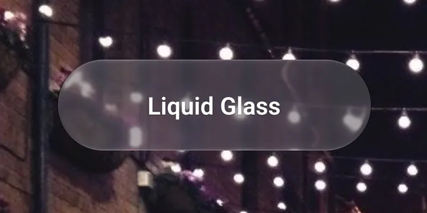
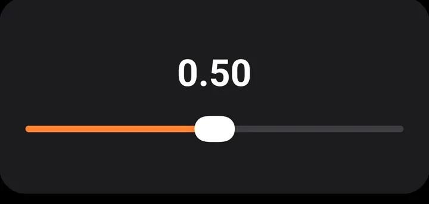
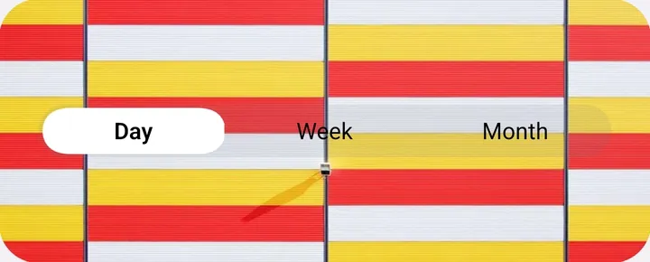

# Lucent

**iOS 26 Liquid Glass for Expo, on Android too.** The glass material, the floating tab bar, search and controls, from one API that copies Expo's own.

[](https://www.npmjs.com/package/expo-lucent)
[](https://docs.expo.dev/versions/v58.0.0/)

[](LICENSE)

<p align="center">
  
</p>

## Why Lucent

iOS 26 brought Liquid Glass, and Expo gives you the real thing on iOS: `expo-glass-effect`, expo-router's `NativeTabs` and `@expo/ui`. On Android, the same code looks like a different app. The tab bar is a Material bottom bar, and the glass falls back to a plain `View`.

Lucent keeps Expo's APIs and fills in Android:

- **On iOS**, every component is the system one. Lucent passes straight through to Expo, so you get Apple's glass, tab bar and controls.
- **On Android**, Lucent draws an iOS-styled recreation: Liquid Glass through its own refraction shader, with iOS shapes, spacing, springs and press physics.

Screens don't branch on the platform. They import from `expo-lucent` and get the right implementation on each, and because the props are Expo's, Expo's docs apply.

## Components

<table>
  <tr>
    <td width="50%"></td>
    <td width="50%"></td>
  </tr>
  <tr>
    <td></td>
    <td></td>
  </tr>
</table>

| Component                                                          | Exports                                                         | On iOS                          | On Android                                                                             |
| ------------------------------------------------------------------ | --------------------------------------------------------------- | ------------------------------- | -------------------------------------------------------------------------------------- |
| [Glass](docs/components/glass.md)                                  | `GlassView`, `GlassContainer`, `GlassBackdrop`                  | `expo-glass-effect`             | Refraction shader that bends, blurs and lights what's behind                           |
| [Tab bar](docs/components/tabs.md)                                 | `NativeTabs`, `TabScrollView`, `useTabBarScroll`                | expo-router's `NativeTabs`      | Floating glass bar with the lens, drag between tabs, minimize, bottom accessory        |
| [Navigation bar](docs/components/stack.md)                         | `Stack`, `useHeaderScroll`, `useHeaderInset`, `useToolbarInset` | expo-router's `Stack`           | Glass bar buttons and bottom toolbar, large title that collapses on scroll, iOS's push |
| [Search bar](docs/components/search.md)                            | `SearchBar`, `useTabSearch`                                     | expo-router's `Stack.SearchBar` | The search tab morphs into a field that rides the keyboard                             |
| [Switch](docs/components/switch.md)                                | `Switch`                                                        | `@expo/ui`                      | Toggle whose thumb turns into a glass lens                                             |
| [Slider](docs/components/slider.md)                                | `Slider`                                                        | `@expo/ui`                      | Thin track with a glass-lens thumb that stretches at the ends                          |
| [Segmented control](docs/components/segmented-control.md)          | `SegmentedControl`                                              | `@expo/ui`                      | Capsule track with a thumb you tap or drag across segments                             |
| [Button](docs/components/button.md)                                | `Button`                                                        | `@expo/ui`                      | iOS capsule buttons in every style, with real glass that lifts when pressed            |
| [Progress view](docs/components/progress-view.md)                  | `ProgressView`                                                  | SwiftUI                         | iOS's grey spinner and thin capsule bar                                                |
| [Stepper](docs/components/stepper.md)                              | `Stepper`                                                       | SwiftUI                         | iOS 26's grey capsule, each side greying at its end                                    |
| [Content unavailable view](docs/components/content-unavailable.md) | `ContentUnavailableView`                                        | `@expo/ui`                      | iOS's centred empty state: grey symbol, bold title, description and actions            |
| [Theming](docs/theming.md)                                         | `LucentProvider`, `useLucentTheme`                              | The accent (`tintColor`)        | Accent, colour scheme, glass opacity and colour overrides                              |

Every component's page in [docs/](docs/README.md) lists its props, what Lucent adds and how Android behaves.

## Requirements

|              | Version                                                                                                                                  |
| ------------ | ---------------------------------------------------------------------------------------------------------------------------------------- |
| Expo SDK     | 58, with expo-router                                                                                                                     |
| React Native | 0.88                                                                                                                                     |
| Build        | A [development build](https://docs.expo.dev/develop/development-builds/introduction/): Lucent ships native code, so Expo Go won't run it |
| iOS          | 16.4+. Liquid Glass needs iOS 26; earlier versions get Expo's own fallbacks                                                              |
| Android      | 7.0+ (API 24). Full refraction on Android 13+, blurred glass on 12, a tinted fill below that                                             |

## Install

Lucent is an add-on for Expo apps: on iOS it renders Expo's own components, on Android it draws them. It has two entry points, so you install only what you use.

**Glass, theming and the controls** (`expo-lucent`):

```sh
npx expo install expo-lucent expo-glass-effect expo-symbols expo-haptics @expo/ui \
  react-native-reanimated react-native-worklets react-native-gesture-handler react-native-svg
```

**The tab bar, navigation bar and search bar** (`expo-lucent/navigation`), on top of the above:

```sh
npx expo install expo-router react-native-screens react-native-safe-area-context react-native-keyboard-controller
```

Then build: `npx expo run:android` or `npx expo run:ios`. Keep `expo-router` in your app config's `plugins`: its config plugin turns on the react-native-screens feature that minimizing the iOS tab bar needs.

## Coming from Expo

If your app already uses Expo's components, switching is a change of import. The props stay the same.

| Before                                                                    | After                                                     |
| ------------------------------------------------------------------------- | --------------------------------------------------------- |
| `import { NativeTabs } from 'expo-router/native-tabs'`                    | `import { NativeTabs } from 'expo-lucent/navigation'`     |
| `import { Stack } from 'expo-router'`                                     | `import { Stack } from 'expo-lucent/navigation'`          |
| `import { GlassView, GlassContainer } from 'expo-glass-effect'`           | `import { GlassView, GlassContainer } from 'expo-lucent'` |
| `import { Switch, Slider, Button } from '@expo/ui'`                       | `import { Switch, Slider, Button } from 'expo-lucent'`    |
| `import { SegmentedControl } from '@expo/ui/community/segmented-control'` | `import { SegmentedControl } from 'expo-lucent'`          |
| `<Stack.SearchBar />` in the search tab's screen                          | `<SearchBar />` from `expo-lucent/navigation`             |

Then wrap the app in `LucentProvider` to set the accent once for both platforms, as below.

## Quick start

```tsx
// app/_layout.tsx
import { LucentProvider } from 'expo-lucent';
import { DarkTheme, DefaultTheme, Stack, ThemeProvider } from 'expo-router';
import { useColorScheme } from 'react-native';

export default function RootLayout() {
  const scheme = useColorScheme();
  return (
    <ThemeProvider value={scheme === 'dark' ? DarkTheme : DefaultTheme}>
      <LucentProvider tintColor="#FF8433">
        <Stack screenOptions={{ headerShown: false }} />
      </LucentProvider>
    </ThemeProvider>
  );
}
```

```tsx
// app/index.tsx
import { Redirect } from 'expo-router';

export default function Index() {
  return <Redirect href="/home" />;
}
```

```tsx
// app/(tabs)/_layout.tsx
import { NativeTabs } from 'expo-lucent/navigation';

export default function TabsLayout() {
  return (
    <NativeTabs minimizeBehavior="onScrollDown">
      <NativeTabs.Trigger name="home">
        <NativeTabs.Trigger.Icon sf="house.fill" md="home" />
        <NativeTabs.Trigger.Label>Home</NativeTabs.Trigger.Label>
      </NativeTabs.Trigger>
      <NativeTabs.Trigger name="search" role="search">
        <NativeTabs.Trigger.Label>Search</NativeTabs.Trigger.Label>
      </NativeTabs.Trigger>
    </NativeTabs>
  );
}
```

```tsx
// app/(tabs)/home/index.tsx
import { GlassView, Switch } from 'expo-lucent';
import { TabScrollView } from 'expo-lucent/navigation';
import { useState } from 'react';

export default function Home() {
  const [enabled, setEnabled] = useState(true);
  return (
    <TabScrollView contentContainerStyle={{ padding: 16 }}>
      <GlassView isInteractive style={{ height: 64, borderRadius: 32 }} />
      <Switch label="Notifications" value={enabled} onValueChange={setEnabled} />
    </TabScrollView>
  );
}
```

```tsx
// app/(tabs)/search/index.tsx
import { SearchBar, TabScrollView } from 'expo-lucent/navigation';
import { useState } from 'react';
import { Text } from 'react-native';

export default function Search() {
  const [query, setQuery] = useState('');
  return (
    <TabScrollView contentContainerStyle={{ padding: 16 }}>
      <SearchBar placeholder="Search" onChangeText={(event) => setQuery(event.nativeEvent.text)} />
      <Text>Results for {query}</Text>
    </TabScrollView>
  );
}
```

## Android notes

- **Glass outside the tab bar** needs to see what's behind it: wrap that content in `GlassBackdrop`. Inside `NativeTabs` it's already set up. See [Glass](docs/components/glass.md#glass-outside-the-tab-bar-android).
- **Glass on glass** works one layer deep. Glass sees other glass behind it, but not a third layer.
- **Opacity:** as with Expo, an opacity below 1 on the glass or a parent can stop it rendering. Animate a wrapper's opacity instead.
- **Glass opacity:** Android has no Clear/Tinted setting like iOS, so `LucentProvider`'s `glassOpacity` sets it for the whole app.
- **Not drawn yet:** `NativeTabs.Trigger.VectorIcon`.
- **Ignored:** Material-only tab bar props such as `indicatorColor` and `rippleColor`, since the bar is iOS-styled.

## Playground

The [example app](example) is a playground with every component in it. Each one has a page where you can change its props, see it react and copy the code for what you set. It runs inside Lucent's tab bar, with a Settings tab for the theme. To add a page, see [example/README.md](example/README.md).

```sh
cd example
npm install
npx expo run:android   # or: npx expo run:ios
```

## Licence

MIT. See [LICENSE](LICENSE).
