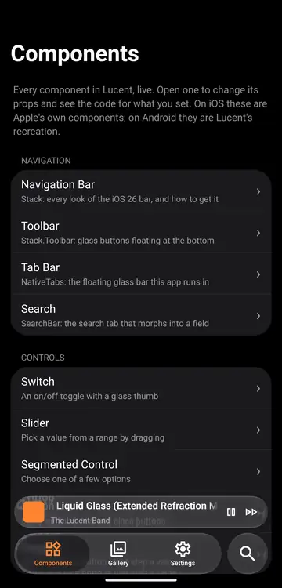

# Lucent

**iOS 26 Liquid Glass for Expo, on Android too.** Glass, the floating tab bar, search and controls, from one component API that copies Expo's own.

- **iOS:** every component is the real system one. Lucent passes straight through to Expo (`expo-glass-effect`, `expo-router`, `@expo/ui`).
- **Android:** Lucent draws an iOS-styled recreation: Liquid Glass through its own refraction shader, with iOS shapes, spacing and springs.

<p align="center">
  
</p>

Because the props copy Expo's, Expo's docs apply. A screen never branches on the platform: it imports from `expo-lucent` and gets the right implementation.

## Components

| Component                                                 | What it is                                                                                   |
| --------------------------------------------------------- | -------------------------------------------------------------------------------------------- |
| [Glass](docs/components/glass.md)                         | `GlassView` and `GlassContainer`, the Liquid Glass material                                  |
| [Tab bar](docs/components/tabs.md)                        | `NativeTabs`: the floating glass bar with the lens, drag between tabs and minimize on scroll |
| [Search bar](docs/components/search.md)                   | `SearchBar`: the search tab morphs into a field that rides the keyboard                      |
| [Switch](docs/components/switch.md)                       | An on/off toggle with a glass thumb                                                          |
| [Slider](docs/components/slider.md)                       | Pick a value from a range                                                                    |
| [Segmented control](docs/components/segmented-control.md) | Choose one of a few options                                                                  |
| [Theming](docs/theming.md)                                | `LucentProvider`: colour scheme, accent, glass opacity and colours                           |

The full docs are in [docs/](docs/README.md).

## Install

Lucent needs a development build (it ships a native module), Expo SDK 58 and expo-router.

```sh
npx expo install expo-lucent expo-router expo-glass-effect expo-symbols expo-haptics @expo/ui \
  react-native-reanimated react-native-worklets react-native-gesture-handler \
  react-native-keyboard-controller react-native-screens react-native-safe-area-context react-native-svg
npx expo run:android   # or: npx expo run:ios
```

Keep `expo-router` in your app config's `plugins`: its config plugin turns on the react-native-screens feature that minimizing the iOS tab bar needs.

## Quick start

```tsx
// app/_layout.tsx
import { LucentProvider } from 'expo-lucent';
import { Stack } from 'expo-router';

export default function RootLayout() {
  return (
    <LucentProvider tintColor="#FF8433">
      <Stack screenOptions={{ headerShown: false }} />
    </LucentProvider>
  );
}
```

```tsx
// app/(tabs)/_layout.tsx
import { NativeTabs } from 'expo-lucent';

export default function TabsLayout() {
  return (
    <NativeTabs minimizeBehavior="onScrollDown">
      <NativeTabs.Trigger name="home">
        <NativeTabs.Trigger.Icon sf="house.fill" md="home" />
        <NativeTabs.Trigger.Label>Home</NativeTabs.Trigger.Label>
      </NativeTabs.Trigger>
      <NativeTabs.Trigger name="search" role="search">
        <NativeTabs.Trigger.Label>Search</NativeTabs.Trigger.Label>
      </NativeTabs.Trigger>
    </NativeTabs>
  );
}
```

```tsx
// app/(tabs)/home/index.tsx
import { GlassView, Switch, TabScrollView } from 'expo-lucent';
import { useState } from 'react';

export default function Home() {
  const [enabled, setEnabled] = useState(true);
  return (
    <TabScrollView contentContainerStyle={{ padding: 16 }}>
      <GlassView isInteractive style={{ height: 64, borderRadius: 32 }} />
      <Switch label="Notifications" value={enabled} onValueChange={setEnabled} />
    </TabScrollView>
  );
}
```

## Playground

The [example app](example) is a playground with every component in it. Each one has its own page where you can change its props, see it react, and copy the code for what you set. It runs inside Lucent's tab bar, with a Settings tab for the theme. Each component's page comes from one small story file; see [example/README.md](example/README.md) to add one.

```sh
cd example
npm install
npx expo run:android   # or: npx expo run:ios
```

## Licence

MIT. See [LICENSE](LICENSE).
