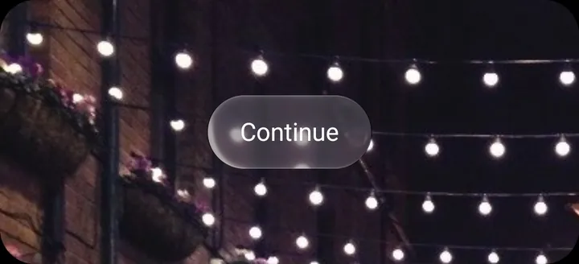

# Button

A tappable button in a filled, outlined, text or glass style. Same API as the `Button` from [`@expo/ui`](https://docs.expo.dev/versions/v58.0.0/sdk/ui/), with iOS 26's glass styles, icons, sizes and a destructive style added.

- **iOS:** SwiftUI's `Button`, through `@expo/ui`, with the matching `buttonStyle`, `controlSize` and `role`.
- **Android:** Lucent's recreation: iOS's capsule shapes, sizes and colours, and real Lucent glass for the glass styles, which lifts and glows under your finger.

<p align="center">
  
</p>

> Try it: in the [playground](../../example), open **Components → Button**.

## Usage

```tsx
import { Button } from 'expo-lucent';

<Button label="Continue" onPress={save} />;
```

The glass styles, an icon, a size and the destructive style:

```tsx
<Button label="Done" variant="glassProminent" onPress={close} />
<Button label="Share" icon={{ sf: 'square.and.arrow.up', md: 'share' }} variant="glass" size="large" onPress={share} />
<Button label="Delete" variant="outlined" destructive onPress={remove} />
```

With an icon and no label, the button is a circle. Give it an `accessibilityLabel` so screen readers can name it:

```tsx
<Button icon={{ sf: 'plus', md: 'add' }} accessibilityLabel="Add" variant="glass" onPress={add} />
```

## Props

| Prop                 | Type                                                              | Default     | Notes                                                                                                     |
| -------------------- | ----------------------------------------------------------------- | ----------- | --------------------------------------------------------------------------------------------------------- |
| `label`              | `string`                                                          | —           | The button's text.                                                                                        |
| `children`           | `ReactNode`                                                       | —           | Custom content in place of `label` and `icon`.                                                            |
| `onPress`            | `() => void`                                                      | —           |                                                                                                           |
| `variant`            | `'filled' \| 'outlined' \| 'text' \| 'glass' \| 'glassProminent'` | `'filled'`  | Lucent adds `glass` (clear glass) and `glassProminent` (glass tinted with the accent).                    |
| `icon`               | `{ sf?: SFSymbol; md?: AndroidSymbol }`                           | —           | Lucent. An SF Symbol on iOS and a Material Symbol on Android, shown before the label.                     |
| `size`               | `'small' \| 'regular' \| 'large'`                                 | `'regular'` | Lucent. SwiftUI's control sizes: 28, 34 and 50 points tall.                                               |
| `destructive`        | `boolean`                                                         | `false`     | Lucent. Draws the button in red, for actions that delete or can't be undone.                              |
| `tintColor`          | `string`                                                          | —           | Lucent. Overrides the accent for this button. Without it, the button uses `LucentProvider`'s `tintColor`. |
| `accessibilityLabel` | `string`                                                          | `label`     | Lucent. What screen readers say; needed for an icon-only button.                                          |
| `disabled`           | `boolean`                                                         | `false`     | Greys the button out and ignores taps.                                                                    |
| `hidden`             | `boolean`                                                         | `false`     | Hides the button but keeps its space.                                                                     |
| `onAppear`           | `() => void`                                                      | —           | Called when the button appears.                                                                           |
| `onDisappear`        | `() => void`                                                      | —           | Called when the button goes away.                                                                         |
| `style`              | `StyleProp<ViewStyle>`                                            | —           | Layout only: margins, alignment and size.                                                                 |
| `testID`             | `string`                                                          | —           |                                                                                                           |
| `modifiers`          | `ModifierConfig[]`                                                | —           | iOS only: `@expo/ui/swift-ui` modifiers, applied after Lucent's. Ignored on Android.                      |

Below iOS 26 there is no glass: `glass` falls back to `outlined` and `glassProminent` to `filled`. Use [`isLiquidGlassAvailable()`](glass.md) to check.

## Colours

As on iOS:

- `filled` and `glassProminent` fill with the accent and have a white label.
- `outlined` sits on a grey fill with an accent label.
- `text` and `glass` have a label in the text colour.
- `destructive` swaps the accent for red.
- `disabled` drops the accent and greys out the label.

The accent is `LucentProvider`'s `tintColor` on both platforms; on iOS it reaches the button through `NativeTabs`, as with `@expo/ui`. `tintColor` on the button overrides it for that button only.

## Android behaviour

- Hold a button and it changes as iOS's do: a filled or outlined button's fill lightens in dark mode and darkens in light mode, and the label fades a little. A glass button lifts and glows under your finger instead, like `GlassView` with `isInteractive`.
- Glass buttons bend what's behind them, so outside `NativeTabs` wrap the content behind them in `GlassBackdrop`. See [Glass](glass.md#glass-outside-the-tab-bar-android).
- The grey fill, red and disabled grey come from `colors` (`buttonFill`, `buttonDestructive`, `buttonDisabled`). See [Theming](../theming.md).
- Custom `children` take the label colour from `useButtonColor()`; plain text as `children` gets it on its own.
- Icons are Material Symbols (`md`); give the `sf` name too and the same `icon` works on iOS.
- Accessibility: announced as a button, with its disabled state.
