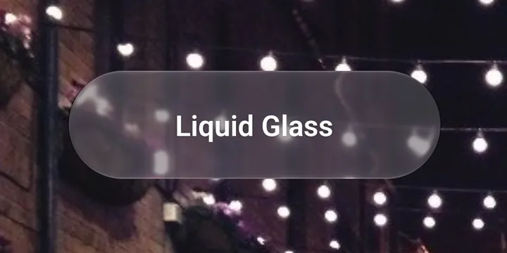

# Glass

The Liquid Glass material. Same API as [`expo-glass-effect`](https://docs.expo.dev/versions/v58.0.0/sdk/glass-effect/): `GlassView`, `GlassContainer`, `isLiquidGlassAvailable` and `isGlassEffectAPIAvailable`.

- **iOS:** these are `expo-glass-effect`'s own exports, so you get Apple's glass.
- **Android:** Lucent's glass: a native refraction shader that bends, blurs and lights the content behind it.

<p align="center">
  
</p>

> Try it: in the [playground](../../example), open **Components → Glass**.

## Usage

```tsx
import { GlassView } from 'expo-lucent';

<GlassView style={{ width: 220, height: 64, borderRadius: 32 }} isInteractive>
  <Text>Liquid Glass</Text>
</GlassView>;
```

The shape comes from the view's `style`: its size and `borderRadius`.

### Blending shapes

Glass inside a `GlassContainer` blends together when two shapes come closer than `spacing`:

```tsx
import { GlassContainer, GlassView } from 'expo-lucent';

<GlassContainer spacing={24} style={{ flexDirection: 'row', gap: 12 }}>
  <GlassView style={{ width: 72, height: 72, borderRadius: 36 }} />
  <GlassView style={{ width: 72, height: 72, borderRadius: 36 }} />
</GlassContainer>;
```

### Glass outside the tab bar (Android)

Glass needs to see what's behind it. Inside `NativeTabs` that's already set up. Anywhere else, wrap the content behind the glass in `GlassBackdrop`. On iOS, `GlassBackdrop` is a plain `View`.

```tsx
import { GlassBackdrop, GlassView } from 'expo-lucent';

<GlassBackdrop style={{ flex: 1 }}>
  <Image source={photo} style={StyleSheet.absoluteFill} />
  <GlassView style={styles.card} />
</GlassBackdrop>;
```

## Props

### GlassView

| Prop               | Type                                                                        | Default     | Notes                                                                     |
| ------------------ | --------------------------------------------------------------------------- | ----------- | ------------------------------------------------------------------------- |
| `glassEffectStyle` | `'regular' \| 'clear' \| 'none' \| { style, animate?, animationDuration? }` | `'regular'` | `clear` is more see-through. Pass `animate: true` to fade between styles. |
| `tintColor`        | `ColorValue`                                                                | —           | Tints the glass.                                                          |
| `isInteractive`    | `boolean`                                                                   | `false`     | Reacts to touches: the glass lifts and glows while pressed.               |
| `colorScheme`      | `'auto' \| 'light' \| 'dark'`                                               | `'auto'`    |                                                                           |

Plus all `View` props.

### GlassContainer

| Prop      | Type     | Default | Notes                                        |
| --------- | -------- | ------- | -------------------------------------------- |
| `spacing` | `number` | —       | The distance at which shapes start to blend. |

Plus all `View` props.

### Functions

| Function                      | iOS                              | Android                                           |
| ----------------------------- | -------------------------------- | ------------------------------------------------- |
| `isLiquidGlassAvailable()`    | `true` on iOS 26+                | `true` on Android 13+ (refraction), `false` below |
| `isGlassEffectAPIAvailable()` | Whether the glass API is present | Always `true`                                     |

## Android notes

- **Fallbacks:** Android 13+ gets full refraction. Android 12 gets blurred glass, and older versions a tinted fill.
- **Glass on glass** works one layer deep: glass sees other glass behind it, but glass on glass on glass is not supported.
- **Glass opacity:** `LucentProvider`'s `glassOpacity` stands in for iOS's Clear/Tinted setting. See [Theming](../theming.md).
- **Opacity:** as with Expo, an opacity below 1 on the glass or a parent can stop it rendering. Animate a wrapper's opacity instead.
