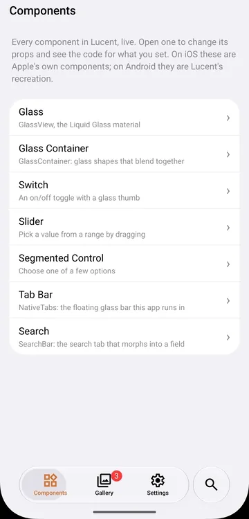

# Search bar

The search tab that turns into a search field. Same props as expo-router's `Stack.SearchBar` (react-native-screens' `SearchBarProps`).

- **iOS:** renders `Stack.SearchBar`; iOS 26 moves it into the tab bar.
- **Android:** renders nothing in the header. It hands its props to the tab bar, which morphs the search tab into the field, shows the X and rides the keyboard.

<p align="center">
  
</p>

> Try it: in the [playground](../../example), tap the search tab. It filters the component list.

## Usage

Give one trigger `role="search"` (see [Tab bar](tabs.md)), then place `SearchBar` in that tab's screen, as you would with expo-router:

```tsx
// app/(tabs)/search/index.tsx
import { SearchBar } from 'expo-lucent';

const [query, setQuery] = useState('');

<SearchBar placeholder="Search" onChangeText={(event) => setQuery(event.nativeEvent.text)} />;
```

## Props

| Prop                  | Notes                                                                           |
| --------------------- | ------------------------------------------------------------------------------- |
| `placeholder`         |                                                                                 |
| `onChangeText`        | `(event) => void`; the text is `event.nativeEvent.text`.                        |
| `onFocus`, `onBlur`   |                                                                                 |
| `onSearchButtonPress` | The keyboard's search key.                                                      |
| `onCancelButtonPress` | On Android, the X next to the field.                                            |
| `autoFocus`           | iOS. On Android, focusing follows the trigger's `automaticallyActivatesSearch`. |
| `autoCapitalize`      |                                                                                 |
| `tintColor`           | Caret colour.                                                                   |
| `ref`                 | See below.                                                                      |

### Ref

| Method               | What it does                                                                      |
| -------------------- | --------------------------------------------------------------------------------- |
| `focus()`, `blur()`  | Opens or closes the keyboard.                                                     |
| `setText(text)`      | Sets the field's text. Doesn't fire `onChangeText`.                               |
| `clearText()`        | Empties the field.                                                                |
| `cancelSearch()`     | Clears the text, fires `onChangeText` and closes the keyboard, staying in search. |
| `toggleCancelButton` | Does nothing: iOS 26 has no cancel button there.                                  |

## `useTabSearch()` (Lucent)

The search tab's state and commands, from any screen inside `NativeTabs`, without a ref or your own query state.

```tsx
import { useTabSearch } from 'expo-lucent';

const { query, isFocused, setText } = useTabSearch();
```

| Field                           | Type      | Notes                                                                   |
| ------------------------------- | --------- | ----------------------------------------------------------------------- |
| `query`                         | `string`  | The field's text, updated as the user types.                            |
| `isFocused`                     | `boolean` | Whether the field has focus.                                            |
| `setText(text)`                 | function  | Sets the field and `query`, and fires the `SearchBar`'s `onChangeText`. |
| `clearText()`                   | function  | Same as `setText('')`.                                                  |
| `focus()`, `blur()`, `cancel()` | function  | Same as the ref's `focus`, `blur` and `cancelSearch`.                   |

## Android behaviour

- While the field has text, it shows iOS's clear button.
- The field sits above the keyboard and follows it as it opens and closes.
- The circle next to the field shows the tab you came from; tap it to leave search and go back to the bar.
