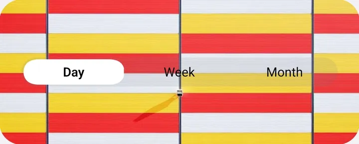

# SegmentedControl

Choose one of a few options. Same API as [`@expo/ui/community/segmented-control`](https://docs.expo.dev/versions/v58.0.0/sdk/ui/), which itself matches the popular `@react-native-segmented-control/segmented-control`.

- **iOS:** the system segmented control, through `@expo/ui`.
- **Android:** Lucent's recreation: a capsule track with a thumb you can tap to move or drag across segments, which turns into a glass lens while held.

<p align="center">
  
</p>

> Try it: in the [playground](../../example), open **Components → Segmented Control**.

## Usage

```tsx
import { SegmentedControl } from 'expo-lucent';

const [index, setIndex] = useState(0);

<SegmentedControl
  values={['Day', 'Week', 'Month']}
  selectedIndex={index}
  onChange={(event) => setIndex(event.nativeEvent.selectedSegmentIndex)}
/>;
```

If you only need the label, use `onValueChange`:

```tsx
<SegmentedControl values={['List', 'Grid']} selectedIndex={0} onValueChange={(value) => setLayout(value)} />
```

## Props

| Prop                 | Type                                                                | Default | Notes                                                       |
| -------------------- | ------------------------------------------------------------------- | ------- | ----------------------------------------------------------- |
| `values`             | `string[]`                                                          | `[]`    | Segment labels, in order.                                   |
| `selectedIndex`      | `number`                                                            | —       | The selected segment.                                       |
| `onChange`           | `(event: { nativeEvent: { selectedSegmentIndex, value } }) => void` | —       | Called when the user picks a segment.                       |
| `onValueChange`      | `(value: string) => void`                                           | —       | Same, with just the label.                                  |
| `enabled`            | `boolean`                                                           | `true`  | `false` dims the control and ignores touches.               |
| `tintColor`          | `string`                                                            | —       | Colour of the selected thumb.                               |
| `appearance`         | `'light' \| 'dark'`                                                 | —       | iOS only. On Android, use `LucentProvider`'s `colorScheme`. |
| `accessibilityLabel` | `string`                                                            | —       | iOS only.                                                   |
| `style`              | `ViewStyle`                                                         | —       | Layout: width, margins. The height is fixed.                |
| `testID`             | `string`                                                            | —       |                                                             |

## Android behaviour

- Tap a segment, or press the thumb and drag it across. The label under your finger turns bold, with a haptic tick, and the thumb lands where you let go.
- The selection updates as soon as you pick a segment, like iOS. If you pass a new `selectedIndex`, the thumb slides to it.
- The track, thumb and shadow come from `colors` (`segmentedTrack`, `segmentedThumb`, `segmentedShadow`); `tintColor` overrides the thumb. See [Theming](../theming.md).
- Accessibility: each segment is a button with a selected state.
