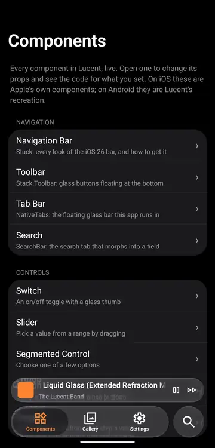

# Tab bar

The iOS 26 floating glass tab bar. Same API as [`expo-router`'s `NativeTabs`](https://docs.expo.dev/versions/v58.0.0/sdk/router-native-tabs/), including `NativeTabs.Trigger`, `.Trigger.Icon`, `.Trigger.Label`, `.Trigger.Badge`, `.Trigger.VectorIcon` and `NativeTabs.BottomAccessory`.

- **iOS:** expo-router's `NativeTabs`, so you get the system tab bar.
- **Android:** Lucent draws the same floating glass bar, with the lens bubble, dragging between tabs, press physics and minimize on scroll.

<p align="center">
  
</p>

> Try it: the [playground](../../example) runs inside `NativeTabs`. Open **Components → Tab Bar** to change its props live.

## Usage

```tsx
// app/(tabs)/_layout.tsx
import { NativeTabs } from 'expo-lucent/navigation';

export default function TabsLayout() {
  return (
    <NativeTabs tintColor="#FF8433" minimizeBehavior="onScrollDown">
      <NativeTabs.Trigger name="home">
        <NativeTabs.Trigger.Icon sf="house.fill" md="home" />
        <NativeTabs.Trigger.Label>Home</NativeTabs.Trigger.Label>
      </NativeTabs.Trigger>
      <NativeTabs.Trigger name="library">
        <NativeTabs.Trigger.Icon sf="books.vertical" md="library_books" />
        <NativeTabs.Trigger.Label>Library</NativeTabs.Trigger.Label>
        <NativeTabs.Trigger.Badge>3</NativeTabs.Trigger.Badge>
      </NativeTabs.Trigger>
      <NativeTabs.Trigger name="search" role="search">
        <NativeTabs.Trigger.Label>Search</NativeTabs.Trigger.Label>
      </NativeTabs.Trigger>
    </NativeTabs>
  );
}
```

`role="search"` puts that tab in its own circle next to the bar, as on iOS 26. Together with [`SearchBar`](search.md) it gives you the search morph.

## Scroll views

Use `TabScrollView` in tab screens. It's a `ScrollView` that:

- shrinks the bar on scroll when `NativeTabs` has a `minimizeBehavior`,
- pads the bottom of the content so it clears the bar (on top of your own `paddingBottom`),
- scrolls to the top when the current tab is tapped again.

```tsx
import { TabScrollView } from 'expo-lucent/navigation';

<TabScrollView contentContainerStyle={{ padding: 16 }}>…</TabScrollView>;
```

It takes `ScrollView` props, except that `onScroll` must be a Reanimated handler (`useAnimatedScrollHandler`).

For lists and custom scroll views, wire them up yourself:

```tsx
import { TabScrollMarker, useTabBarInset, useTabBarScroll } from 'expo-lucent/navigation';
import Animated from 'react-native-reanimated';

const onScroll = useTabBarScroll();
const inset = useTabBarInset();

<TabScrollMarker>
  <Animated.FlatList onScroll={onScroll} contentContainerStyle={{ paddingBottom: inset }} … />
</TabScrollMarker>;
```

On Android `useTabBarScroll` and `useTabBarInset` do the work. On iOS they're no-ops, and `TabScrollMarker` tells the system tab bar which view scrolls.

Keep `expo-router` in your app config's `plugins`: its config plugin turns on the react-native-screens feature that `TabScrollMarker` needs to minimize the iOS tab bar.

## Lucent additions

| Prop                                                | Type                                | Default | Notes                                                                                                                                      |
| --------------------------------------------------- | ----------------------------------- | ------- | ------------------------------------------------------------------------------------------------------------------------------------------ |
| `NativeTabs.Trigger` `automaticallyActivatesSearch` | `boolean`                           | `true`  | Selecting the search tab focuses the field. On iOS this sets the native flag that expo-router only exposes through `unstable_nativeProps`. |
| `NativeTabs.Trigger.Icon` `svg`                     | `string \| { default?, selected? }` | —       | SVG markup for the icon, in place of `src`, `sf` or `md`. Drawn natively at the screen's scale and cached, on both platforms.              |

```tsx
<NativeTabs.Trigger.Icon svg={{ default: homeOutline, selected: homeFilled }} />
```

The `svg` icon supports `path`, `circle`, `ellipse`, `rect`, `line`, `polyline`, `polygon` and `g`, with `fill`, `stroke`, `stroke-width`, `stroke-linecap`, `stroke-linejoin` and `fill-rule`. Masks, gradients and transforms are ignored. `renderingMode` defaults to `template`.

## Android behaviour

- **Without a `role="search"` trigger**, the bar spans the full width, as on iOS.
- **Drag across the bar** and the lens follows your finger, landing on the tab you let go over.
- **Tapping the current tab again** pops the tab's stack back to its first screen or, when already there, scrolls its `TabScrollView` to the top. The trigger's `disablePopToTop` and `disableScrollToTop` turn each off.
- **`Badge`** draws a red capsule at the icon's top-right; an empty badge is a plain red dot. `badgeBackgroundColor`, `badgeTextColor` and the badge's `selectedBackgroundColor` apply. In search mode the back button keeps its tab's badge.
- **A `disabled` tab** looks normal and still reacts to a tap or drag, but the lens slides back to the current tab and nothing navigates.
- **`minimizeBehavior`:** `onScrollDown` and `onScrollUp` work as on iOS. `automatic` and `never` don't minimize, which is what iOS does on iPhone.
- **Icons** use `md` (Material Symbol), an image `src` or Lucent's `svg`. `VectorIcon` isn't drawn yet.
- **`NativeTabs.BottomAccessory`** isn't drawn yet.
- **Ignored props:** the Material-only props (`indicatorColor`, `rippleColor`, `labelVisibilityMode`, `disableIndicator`) are accepted and ignored, since the bar is iOS-styled. Props that only affected iOS before 26 (`blurEffect`, `shadowColor`, `backgroundColor`) are ignored on both platforms, matching iOS 26.
